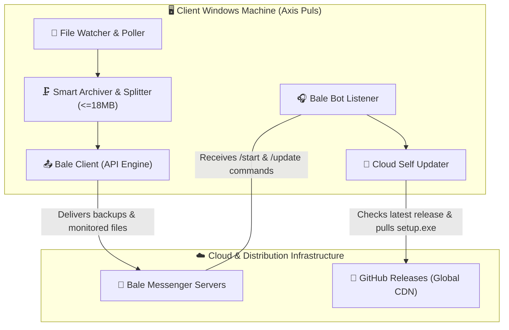

# ⚡ Axis Puls (اکسیس پالس)
### Intelligent File Surveillance, Smart Multipart Archiving & Cloud Auto-Deployment
### سامانه جامع پایش لحظه‌ای پوشه‌ها، آرشیو و تقسیم هوشمند فایل‌ها، و استقرار خودکار

<div align="center">


[](https://github.com/axispuls/axispuls1/releases)
[](https://github.com/axispuls/axispuls1)
[](https://www.python.org)
[](https://pytest.org)
[](https://ble.ir/AXISPULS)
[](https://instagram.com/axis_puls)

---

<!-- Language Switcher & Quick Navigation -->
[English Overview](#-english-overview) • [راهنمای فارسی](#-معرفی-و-ویژگی‌های-سیستم-به-فارسی) • [معماری سیستم](#-system-architecture--معماری-سیستم) • [راه‌های ارتباطی](#-connect-with-us--راه‌های-ارتباطی)

---

</div>

## 🏗️ System Architecture / معماری سیستم



---

## 🇬🇧 English Overview

### What is Axis Puls?
**Axis Puls** is an enterprise-grade Windows background service designed for continuous directory monitoring, instant single-dispatch transmission of newly detected files to **Bale Messenger**, and autonomous fail-safe operations. It completely solves large file transmission constraints by utilizing an intelligent deflate multi-part archiver that splits files strictly below Bale's 20 MB threshold (safely at 18 MB chunks).

### 🌟 Key Features (English)
1. **Single-File Standalone Binary:**  
   Compiled into a portable Windows executable (`dist/AxisPuls_Setup.exe`). Requires zero Python runtime, dependencies, or external configurations on target systems.
2. **Modern Slate Gray & White UI:**  
   Crafted with CustomTkinter for high DPI screens, featuring clipboard management and responsive card-based telemetry.
3. **Smart Bale Bot Remote Control:**  
   Admins can monitor system status, hardware telemetry, inspect logs, and remotely trigger updates via interactive inline buttons in Bale.
4. **Hardware-Locked HMAC Licensing:**  
   Tied to motherboard, CPU, and disk serials with Melipayamak SMS verification and strict 24-hour rate limiting.
5. **Send-Once Guarantee:**  
   Persistent state tracking ensures no file is ever duplicated or retransmitted across restarts.
6. **Automatic Deflate Multipart Archiver:**  
   Large databases or backups (>20MB) are compressed and chunked into `.zip.001`, `.zip.002` sequences with SHA256 integrity validation.
7. **24/7 Windows Persistence:**  
   Auto-registers in Windows Task Scheduler and Startup Registry to survive reboots, power cuts, and unexpected shutdowns.
8. **Cloud-Assisted GitHub Auto-Updater:**  
   Integrates directly with GitHub Releases API. When `/update` is triggered, the client polls the latest release, downloads the setup binary from GitHub CDN, hot-swaps the running executable, and restarts itself seamlessly.

---

## 🇮🇷 معرفی و ویژگی‌های سیستم (به فارسی)

### اکسیس پالس چیست؟
این نرم‌افزار به صورت یک سرویس هوشمند، دائمی و خودکار در سیستم‌عامل ویندوز عمل می‌کند. هدف اصلی **اکسیس پالس** پایش پیوسته پوشه انتخابی، شناسایی فایل‌های جدید، ارسال قطعی و تک‌باره هر فایل به پیام‌رسان **بله**، و مدیریت فشرده‌سازی پارت‌های بالای ۲۰ مگابایت است.

### 🌟 ویژگی‌های برجسته:
1. **توزیع به صورت تک‌فایل مستقل ستاپ (`dist/AxisPuls_Setup.exe`):**  
   بدون نیاز به نصب پایتون یا هر پیش‌نیاز دیگر بر روی ویندوزهای ۱۰، ۱۱ و سرور.
2. **رابط کاربری مدرن سفید و طوسی روشن:**  
   طراحی خلوت و چشم‌نواز با دسترسی کامل به منوی راست‌کلیک و کلیدهای میانبر کپی.
3. **سیستم مجوز و فعال‌سازی یک‌ساله:**  
   ثبت و اعتبارسنجی پیامکی از طریق ملی‌پیامک با قفل سخت‌افزاری و امضای دیجیتال HMAC-SHA256.
4. **تضمین ارسال تک‌باره (Send-Once Guarantee):**  
   جلوگیری قطعی از ارسال فایل‌های تکراری و ثبت تاریخچه در فایل‌های مقاوم در برابر قطعی برق.
5. **پارت‌بندی خودکار فایل‌های بالای ۲۰ مگابایت:**  
   فشرده‌سازی خودکار و تبدیل به پارت‌های زیر ۱۸ مگابایت با پسوندهای استاندارد چندبخشی (`filename.zip.001`, `filename.zip.002`, ...).
6. **ماندگاری دائمی (Persistence):**  
   ثبت خودکار در زمان‌بندی ویندوز (Task Scheduler) و رجیستری جهت راه‌اندازی پس از ریستارت یا قطعی برق.
7. **به‌روزرسانی خودکار ابری از گیت‌هاب (GitHub Releases):**  
   استعلام مستقیم نسخه با دکمه ربات، دانلود با سرعت بالا از CDN جهانی، و تعویض فایل و اجرای مجدد بدون نیاز به دخالت دست.

---

## 🧪 Automated Test Suite (89 Tests Passed)
The application includes a comprehensive test suite covering all modules:
```powershell
pytest tests/
# ================= 89 passed in 30.99s =================
```
- `tests/test_github_updater.py`: Version comparisons, release polling & asset downloads.
- `tests/test_bale_listener.py`: Admin commands, keyboards, and remote update routines.
- `tests/test_archiver.py`: Multipart zip splitting and SHA256 integrity verification.
- `tests/test_license_manager.py`: Hardware fingerprinting & anti-tampering guards.
- `tests/test_security_audit.py`: Path traversal protection and sensitive token masking.

---

## 📬 Connect with Us / راه‌های ارتباطی

<div align="center">

| کانال ارتباطی | Channel | Link |
| :--- | :--- | :--- |
| 📸 **اینستاگرام رسمی** | Official Instagram | [instagram.com/axis_puls](https://instagram.com/axis_puls) |
| 💬 **کانال و پشتیبانی بله** | Bale Messenger | [ble.ir/AXISPULS](https://ble.ir/AXISPULS) |
| ✈️ **کانال تلگرام** | Telegram Channel | [t.me/AXISPULS](https://t.me/AXISPULS) |
| 🐙 **مخزن گیت‌هاب** | GitHub Repository | [github.com/axispuls/axispuls1](https://github.com/axispuls/axispuls1) |

<br/>

<sub>Developed with ❤️ & ⚡ by **Axis Puls** Engineering Team</sub>

</div>
