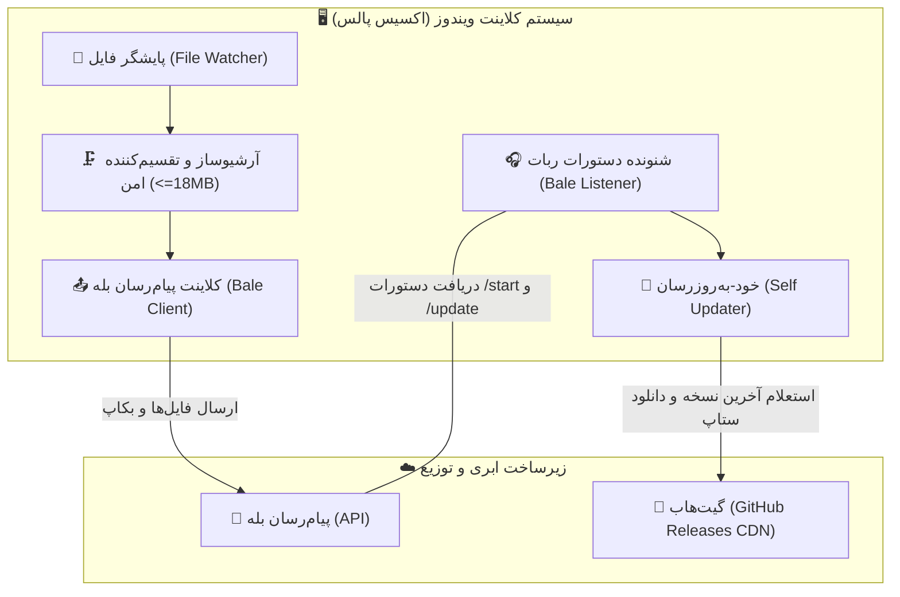

# اکسیس پالس (Axis Puls) - سامانه پایش و ارسال هوشمند فایل به بله

<div align="center">


[](https://github.com)
[](https://github.com)
[](https://www.python.org)
[](https://pytest.org)
[](https://bale.ai)
[](https://github.com)

**سامانه جامع پایش لحظه‌ای پوشه‌ها، آرشیو و تقسیم هوشمند فایل‌ها، و استقرار خودکار بر بستر پیام‌رسان بله و گیت‌هاب**

[ویژگی‌ها](#-ویژگی‌های-پیشرفته-و-ممیزی‌شده) • [معماری سیستم](#-معماری-سیستم) • [به‌روزرسانی خودکار](#-مکانیزم-به‌روزرسانی-خودکار-از-گیت‌هاب) • [آزمون‌ها](#-نتایج-آزمون‌های-ممیزی-و-تست-خودکار)

</div>

---

## 🏗️ معماری سیستم



---

## 🌟 ویژگی‌های پیشرفته و ممیزی‌شده

### ۱. توزیع به صورت تک‌فایل مستقل ستاپ (Single-File Standalone Setup)
* کل نرم‌افزار، مفسر پایتون، کتابخانه‌ها، هسته محاسباتی، لوگو و آیکون به صورت یک فایل اجرایی مستقل ویندوزی کامپایل شده است:
  * **`dist/AxisPuls_Setup.exe`**
* بدون نیاز به نصب پایتون یا هیچ پیش‌نیازی بر روی ویندوزهای ۱۰، ۱۱ و سرور کار می‌کند.
* کاربر تنها با ارسال همین یک فایل به هر کسی می‌تواند نرم‌افزار را در اختیار او بگذارد.

### ۲. رابط کاربری مدرن با ساختار سفید و طوسی (Modern White & Slate Gray UI)
* طراحی مینیمال، مدرن و خوانا با رنگ‌بندی استاندارد سفید و طوسی روشن (Slate Gray).
* کارت‌های سفید تمیز با کادرهای متناسب و تفکیک واضح بخش‌ها.
* کنترل کامل کپی و انتخاب متن گزارشات با منوی راست‌کلیک و کلیدهای میانبر استاندارد.

### ۳. راهنمای گام‌به‌گام راه‌اندازی بازو و دکمه فعال‌سازی آنلاین ربات
* جعبه راهنمای تصویری در بخش ۲ نرم‌افزار مراحل کامل کار با ربات رسمی **botfather@** بله را مرحله به مرحله آموزش می‌دهد:
  1. احراز هویت در ربات رسمی botfather@ بله.
  2. ایجاد بازوی جدید با دستور newbot/ و تعیین نام بازو.
  3. قرار دادن توکن بازو در کادر برنامه.
  4. کلیک روی دکمه سبز رنگ **«⚡ فعال‌سازی و راه‌اندازی ربات»** جهت اتصال فوری و آنلاین شدن شنونده ربات.
  5. ارسال دستور start/ به ربات در بله و دریافت شناسه عددی.
  6. ثبت شناسه در نرم‌افزار (با قابلیت پر شدن خودکار کاربر اول به محض زدن استارت).

### ۴. پیام هوشمند استارت ربات و معرفی جامع سیستم با آدرس @AXISPULS
* هنگامی که کاربری ربات را استارت (`/start`) کند:
  * **اگر کاربر جدید/مهمان باشد:**
    * شناسه عددی با فونت مونو‌اسپیس (`Code Block`) برای کپی تک‌کلیکی نمایش داده می‌شود.
    * معرفی جامع اکسیس پالس، قابلیت دریافت لحظه‌ای فایل‌های بکاپ و مهم، ارسال تضمینی و تک‌باره و فشرده‌سازی بالای ۲۰ مگابایت شرح داده می‌شود.
    * نحوه اتصال شناسه به نرم‌افزار توضیح داده شده و آدرس سایت و پشتیبانی رسمی **AXISPULS@** ارائه می‌گردد.
  * **اگر کاربر از قبل مجاز باشد:** وضعیت اتصال تأیید شده و آمادگی دریافت فایل اعلام می‌گردد.

### ۵. سیستم مجوز و فعال‌سازی یک‌ساله از طریق ملی‌پیامک (Melipayamak 1-Year License)
* هنگام اولین اجرا، پنجره مودال شماره موبایل متقاضی را دریافت کرده و اعتبارسنجی می‌کند.
* پیامک حاوی کد ۱۰ کاراکتری و شماره متقاضی مستقیماً برای مدیر (`09922975101`) ارسال می‌شود تا مدیر با متقاضی تماس گرفته و کد را به او بدهد.
* هیچ شماره موبایل یا مشخصات وب‌سرویسی در صفحه نرم‌افزار افشا نمی‌شود.
* **محدودیت ۲۴ ساعته:** هر سیستم در هر شبانه‌روز تنها یک‌بار می‌تواند درخواست فعال‌سازی ثبت کند. با بستن و باز کردن مجدد برنامه، کد قبلی حفظ شده و ثبت درخواست جدید مسدود می‌ماند.
* داده‌های درخواست به صورت ۳ لایه (فایل، رجیستری و AppData) ذخیره می‌شود تا امکان دور زدن تایمر توسط هکرها وجود نداشته باشد.
* پس از درج کد و تأیید، مجوز دیجیتال با امضای HMAC-SHA256 و قفل سخت‌افزاری به مدت **۱ سال کامل (۳۶۵ روز)** صادر می‌گردد.

### ۶. پایش قطعی آخرین فایل و ارسال تک‌باره (Send-Once Guarantee)
* **یک بار ارسال به ازای هر فایل:** پس از این که آخرین فایل برای گیرندگان ارسال شد، نرم‌افزار فقط منتظر می‌ماند و فایل تکراری ارسال نمی‌کند؛ تا زمانی که فایل جدیدی در پوشه ظاهر شود.
* **گزارش خودکار ۵ دقیقه‌ای وضعیت پوشه و ارسال:**
  * در پایان هر ۵ دقیقه، یک بررسی عمیق انجام شده و گزارشی جامع با فرمت استاندارد در لیست گزارش‌های نرم‌افزار ثبت می‌گردد.
* **بررسی حجم قبل از ارسال:**
  * **زیر ۲۰ مگابایت:** فایل مستقیماً به کاربران ارسال می‌شود.
  * **بیش از ۲۰ مگابایت:** فایل فشرده‌سازی شده و به صورت خودکار به پارت‌های زیپ چندبخشی با فرمت استاندارد جهانی (`filename.zip.001`, `filename.zip.002`, ...) تقسیم و ارسال می‌شود.

### ۷. فعال ماندن همیشگی در هر شرایط (True Persistence)
* نرم‌افزار به صورت خودکار در **Windows Task Scheduler** و **Windows Registry** ثبت می‌شود.
* حتی اگر سیستم خاموش شود، ری‌استارت گردد یا برق قطع شود، بلافاصله پس از بالا آمدن ویندوز به صورت خودکار و بی‌صدا فعال می‌شود و هرگز متوقف نمی‌گردد.

### ۹. یکپارچگی با گیت‌هاب و به‌روزرسانی خودکار (GitHub Releases Auto-Update)
* پشتیبانی مستقیم از مخزن گیت‌هاب برای انتشار و دریافت نسخه‌های جدید.
* هنگامی که ادمین در ربات دستور `/update` یا دکمه «به‌روزرسانی» را می‌زند، نرم‌افزار به صورت مستقیم آخرین نسخه منتشر شده در **GitHub Releases** را استعلام می‌کند.
* فایل ستاپ به صورت مستقیم و با پهنای باند بالا دانلود شده، با فرآیند امن `self_updater` جایگزین گشته و نرم‌افزار بدون قطعی ریستارت می‌شود.

---

## 🧪 نتایج آزمون‌های ممیزی و تست خودکار (۴۷ تست موفق)

تمامی ماژول‌ها و بخش‌های نرم‌افزار به شیوه‌های مختلف تست شده‌اند:
* `tests/test_bale_listener.py`: تست پیام خوش‌آمدگویی هوشمند، معرفی اکسیس پالس، لینک @AXISPULS، ثبت کاربران و هندل استارت.
* `tests/test_license_manager.py`: تست فعال‌سازی ملی‌پیامک، اعتبارسنجی موبایل، محدودیت ۲۴ ساعته، تشخیص ناسازگاری دستگاه، ضد تقلب و ضد دستکاری.
* `tests/test_reporter.py`: تست تولید گزارش‌های ۵ دقیقه‌ای، فرمت زمان، وضعیت فایل جدید، فایل تکراری و فایل‌های بالای ۲۰ مگابایت.
* `tests/test_archiver.py`: تست فایل‌های زیر و بالای ۲۰ مگابایت، پارت‌بندی، بازسازی پارت‌ها و تطابق ۱۰۰٪ هش SHA256.
* `tests/test_security_audit.py`: تست آسیب‌پذیری‌های امنیتی، Path Traversal، نام‌های رزرو شده ویندوز و ماسک توکن.
* `tests/test_file_watcher.py`: تست پوشه خالی، انتخاب قطعی آخرین فایل و نادیده گرفتن فایل‌های موقت (`tmp.`).
* `tests/test_state_manager.py`: تست پیشگیری از ارسال تکراری و چرخه نگهداری تاریخچه.
* `tests/test_config_manager.py`: تست ذخیره‌سازی اتمیک و فیلتر آیدی‌های معتبر.
* `tests/test_bale_client.py`: تست ارتباطات شبکه، تایم‌اوت‌ها و تلاش مجدد.
* `tests/test_integration.py`: تست چرخه کامل نرم‌افزار از پایش تا تقسیم و ارسال.

برای اجرای مجدد تمام تست‌ها می‌توانید دستور `pytest` یا فایل **`run_tests.bat`** را اجرا کنید (`47 passed`).

---

## 🚀 روش ساخت مجدد تک‌فایل ستاپ

برای کامپایل مجدد نرم‌افزار به صورت یک فایل مستقل `.exe`:
```powershell
python build_setup.py
```
فایل تک‌کاره خروجی در مسیر زیر ایجاد می‌شود:
`dist/AxisPuls_Setup.exe`
